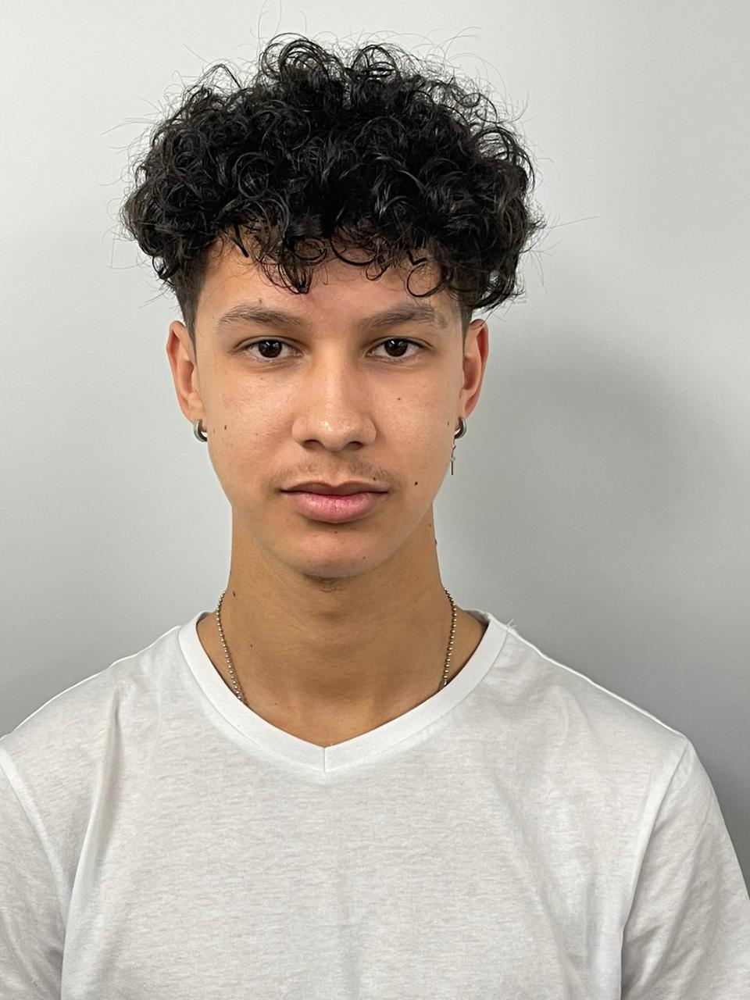

# Ethan Williams

---

  

---

## 📞 Contact

- **Phone:** 0794827072
- **Address:** 136 Third Avenue, Grassy Park
- **Email:** 221454780@mycput.ac.za
- **LinkedIn:** [Ethan Williams](http://www.linkedin.com/in/ethan-williams-a768ba267)

---

## 🎯 Career Objective

Third-year Diploma in ICT (Application Development) student seeking a **Work Integrated Learning (WIL)** opportunity to apply `Java`, `SQL`, and front-end development skills in a practical software development environment.

---

## 💻 Technical Skills

### 🧠 Languages

### 🌐 Web Technologies

### ⚙️ Tools & Platforms

---

## 🎓 Education

### Fairmount Secondary School

National Senior Certificate | 2020

### Cape Peninsula University of Technology (CPUT)

Higher Certificate in ICT | 2023

### Cape Peninsula University of Technology (CPUT)

Diploma in ICT: Application Development (Third Year) | 2024–Present

---

## 📂 Academic Projects

### 🎓 Student Management System – Java Desktop Application | 2025

- Collaborated in a team of three to develop a Java Swing desktop application.
- Applied object-oriented programming principles, including encapsulation, inheritance, and polymorphism.
- Integrated an SQL database for persistent data storage.
- Designed GUI components with validation and error handling.

🔗 [View the GitHub repository](https://github.com/EthanWilliams02/Term4_ADP_Assignment.git)

---

### 📱 NSFAS App Redesign – UI/UX Project | 2025

- Worked in a team to redesign the NSFAS mobile application interface.
- Analysed usability issues and improved layout, navigation, and user flow.
- Created wireframes and high-fidelity prototypes using Figma.
- Focused on accessibility and overall user experience improvements.

🎨 [View the Figma prototype](https://www.figma.com/proto/2o459QPq1FgqfB1zrhvukq/Untitled?node-id=0-1)

---

## 🌧️ SAEON Real-Time Rainfall Monitoring System | 2026

### Project Overview

The SAEON Real-Time Rainfall Monitoring System is an ESP32-based project designed to improve access to environmental readings from remote monitoring sites.

The project addresses the delays and field visits associated with manually retrieving information from USB data loggers. The proposed monitoring station measures rainfall and temperature and sends readings through cellular communication to a live dashboard.

### System Components

- **ESP32 WROOM-32:** Processes sensor readings and runs the station firmware.
- **TR-525M rain gauge:** Measures rainfall through tipping-bucket events.
- **SHT31 temperature & humidity sensor:** Measures temperature.
- **SIM7000G:** Provides cellular connectivity.
- **Firebase:** Stores monitoring records for the dashboard.
- **Dashboard:** Displays current and historical readings, station information, and CSV exports.

### My Role and Contribution

**Role:** Analyst, Researcher and Writer

My responsibilities include:

- Researching project requirements and component choices.
- Documenting the system architecture and data flow.
- Preparing sample data and reviewing displayed measurements.
- Organising test evidence and analysing recorded results.
- Writing setup instructions and technical documentation.
- Preparing presentation content and explaining project findings.

## 📋 Agile Portfolio of Evidence

The following sections present the team’s planning documents and my individual logbook. Each section includes evidence and a reflection on my learning.

### Portfolio Navigation

- [Agile Team Charter](#agile-team-charter)
- [User Stories and Tasks](#user-stories-and-tasks)
- [Product Backlog](#product-backlog)
- [Sprint Backlog](#sprint-backlog)
- [My Agile Logbook](#my-agile-logbook)
- [Overall Project Reflection](#overall-project-reflection)

---

### Agile Team Charter

#### Evidence

📄 **[View the Agile Team Charter](./evidence/Agile%20Team%20Charter%20SAEON.pdf)**

The charter defines our shared purpose, team roles, working agreements, communication practices, decision-making process, milestones, risks, and Definition of Done.
It provides a common understanding of how we work together and what the project aims to achieve.

#### Reflection

Working with the team charter helped me understand how my research and documentation responsibilities connect with the work of the developers and the project leader. I learned that assigning roles is only useful when the team also agrees on communication, review, and completion expectations.

One challenge was keeping the charter consistent with the project as the scope and schedule developed. Comparing it with the backlogs showed me why a charter needs regular review. In future projects, I would check these documents together at each milestone so that changes are recorded earlier and everyone works from the same plan.

---

### User Stories and Tasks

#### Evidence

📄 **[View the User Stories and Tasks](./evidence/SAEON%20User%20Stories%20and%20Tasks.pdf)**

This document contains 13 user stories describing the needs of researchers, station operators, and maintainers.
Each story includes acceptance criteria and practical tasks. The stories cover rainfall and temperature measurement, remote transmission, storage, dashboard access, historical data, exports, station health, power, deployment, and maintenance.

#### Reflection

The user stories helped me connect the technical work to the people who need the system. For example, automatic rainfall monitoring is valuable because a researcher needs access to readings without travelling to a station to retrieve a data logger.

I found it useful to separate the user’s need from the tasks required to meet it. Acceptance criteria also made the expected result clearer, such as displaying rainfall in millimetres and identifying outdated readings. This taught me to describe what successful behaviour looks like instead of simply listing components or features. I would use more concrete test examples when developing future stories.

---

### Product Backlog

#### Evidence

📄 **[View the Product Backlog](./evidence/SAEON%20Product%20Backlog.pdf)**

The product backlog organises the project into 13 sprint groups. It contains 62 cards in total: 13 sprint headings and 49 task cards.
The work covers planning, sensor firmware, cloud communication, dashboard development, power integration, assembly, testing, documentation, and presentation preparation.
Its progress columns distinguish completed work from the deployment and field-validation activities still in progress.

#### Reflection

The product backlog helped me understand the full amount of work involved in the project. It showed that research and documentation support development throughout the project, rather than only being completed at the end.

Reviewing the backlog also highlighted dependencies. For example, meaningful dashboard testing depends on having an agreed message format and usable sensor data. I learned that priorities and statuses need regular attention as the project changes. I would improve future backlog management by linking each task to its evidence and checking that the status shown in the documents agrees with the team’s tracking board.

---

### Sprint Backlog

#### Evidence

📄 **[View the Sprint Backlog](./evidence/SAEON%20Sprint%20Backlog.pdf)**

The sprint backlog breaks the 13-week plan into weekly goals and daily tasks. It identifies task leads, dependencies, acceptance checks, and the evidence needed for review.
My allocated work focuses on research, architecture documentation, reviewing results, preparing technical guides, and developing presentation content.

#### Reflection

The sprint backlog made the larger project easier to approach by showing the work expected during each week. It helped me see when my documentation needed information from the hardware, backend, and frontend work.

A useful lesson was that completing a document does not automatically mean the system has passed every test. The prototype handover and final field validation have different completion requirements. I learned to make those boundaries clear when recording progress. In future, I would review task dependencies and available time more carefully during planning, then carry unfinished work forward explicitly instead of assuming the original schedule still applies.

---

### My Agile Logbook

#### Evidence

📄 **[View Ethan Williams’s Agile Logbook](./evidence/SAEON%20Agile%20Logbook%20Ethan.pdf)**

My individual logbook records:

- Work completed since the previous update.
- Work planned before the next update.
- Current impediments, dependencies, and risks.

#### Reflection

The logbook helped me distinguish what I had worked on from what I still needed to do. It also encouraged me to identify dependencies instead of recording only successful progress.

The early August entries describe practical difficulties involving sensor availability, breadboard space, and the ESP32 cloud connection. These examples helped me see how hardware and connectivity problems affect planning and documentation. I learned that useful entries should be specific and written close to the time the work takes place. In future, I would attach task IDs, screenshots, or test notes to each update so that my contribution and the supporting evidence are easier to follow.

---

### Overall Project Reflection

The SAEON project helped me understand how Agile documents work together. The charter establishes shared expectations, user stories explain the users’ needs, the product backlog organises the work, the sprint backlog sets out shorter-term goals, and the logbook records individual progress.

As the Analyst, Researcher and Writer, I learned how important it is to keep requirements, technical explanations, and evidence consistent. I also developed a clearer understanding of how sensors, cellular communication, cloud services, and a dashboard depend on one another.

The project reinforced the importance of communicating limitations honestly. A working prototype and completed documentation do not remove the need for deployment checks and field validation. These lessons are relevant to my preparation for Work Integrated Learning, where clear communication and reliable records are part of delivering useful software.

---

## 📌 References

### Bhadra Ranchod

Cape Peninsula University of Technology  
📞 082-495-9912  
📧 ranchodb@cput.ac.za

---

### Richard Maliwatu

Cape Peninsula University of Technology  
📞 071-077-9922  
📧 maliwatur@cput.ac.za

---

## 📄 CV of Ethan Williams

**[View My CV](./CV%20of%20Ethan%20Williams.pdf)**

---

## 🎥 Mock Interview Video

<video width="700" controls>
  <source src="Mock Interview of Ethan Williams.mp4" type="video/mp4">
  Your browser does not support embedded video.
</video>

**[Watch or download my mock interview](./Mock%20Interview%20of%20Ethan%20Williams.mp4)**

---

## Reflection on Markdown

I started with no experience in Markdown and found it challenging to create professional and well-structured README files at first. I had to learn how different formatting elements work and how to organize content properly. To improve, I practiced by experimenting with headings, images, and layouts, and I paid attention to how small changes affected the overall presentation. Over time, I became more comfortable using Markdown, and I am now confident in producing clean, organized, and professional documentation that makes my projects easier to understand.

---

## Reflection on Mock Interview

I felt nervous going into the mock interview because I didn’t have much experience speaking in that kind of setting. However, I wanted to improve my communication skills and build my confidence. I prepared my answers beforehand and made an effort to speak clearly and stay calm during the interview. This experience helped me become more aware of how I present myself and how I answer questions, and it left me feeling more confident and better prepared for real interview situations.

---

## Reflection on GitHub Pages

I initially found deploying with GitHub Pages confusing and unfamiliar, especially since it was my first time putting a project online. Despite this, I was determined to successfully publish my work. I followed the setup steps carefully and worked through any errors by troubleshooting and trying again until everything worked correctly. In the end, I managed to get my project live, which gave me a strong sense of achievement and made me feel more confident in my ability to deploy and share my work online.
